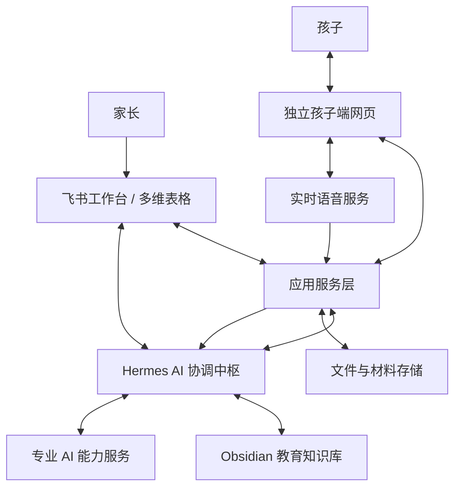
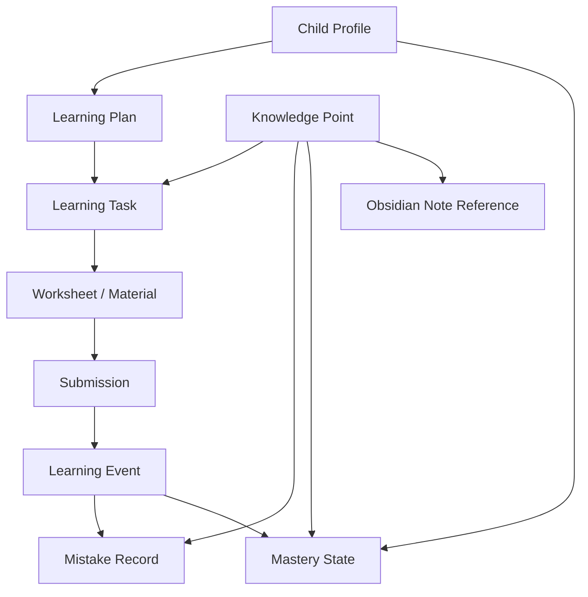

# AI 家庭学习系统产品需求文档（PRD）

**版本：** V1.0  
**日期：** 2026-11-09  
**状态：** 产品基线版，可进入技术拆解与分阶段实施规划  
**交付对象：** Hermes 协调中枢及后续产品、设计、研发执行角色  
**产品暂定名称：** AI 家庭学习系统（Personal AI Learning System）

---

## 0. 给 Hermes 的执行说明

本文件定义产品目标、用户体验、业务流程、核心数据对象、系统职责边界和验收标准。它是产品需求基线，不是对现有代码、运行环境或技术栈的假设。

### 0.1 执行要求

1. **先盘点、后实施。** 先检查现有 Hermes、飞书应用/多维表格、Obsidian Vault、文件存储、网页项目及已有自动化；输出资产清单、复用建议和差距分析。不得假设这些组件尚不存在，也不得先创建重复系统。
2. **先输出实施方案，再进入开发。** 提交系统边界图、数据模型、接口清单、权限方案、部署方案、风险清单和里程碑；产品基线没有覆盖的决策列为待确认项。
3. **优先完成一条端到端纵向闭环。** 第一条主链路建议为“数学纸笔练习：生成材料 → 打印 → 作答 → 拍照上传 → 识别/批改 → 人工确认 → 更新学习记录 → 孩子端反馈”。不以先建很多空表、先做大量 Agent 为完成标准。
4. **保护现有数据。** 不删除、不覆盖、不批量迁移现有文件或数据；涉及不可逆操作、外部发布、真实账号权限变更、付费资源启用时，先提交计划并等待用户批准。
5. **事实与推断分离。** 识别结果、批改结果、错误原因诊断、知识掌握判断必须分别记录；不允许把模型推断直接写成确定事实。
6. **可追踪、可重放。** 每一次任务、材料生成、上传、识别、批改、人工修正和学习状态更新都应保留关联 ID、时间、来源和版本。
7. **分阶段交付。** 每个里程碑都要提交可验证产物、测试结果、未解决问题和下一步建议。未经确认，不扩展到与当前里程碑无关的功能。

### 0.2 首轮需要 Hermes 交付的内容

在编写或修改代码之前，先交付：

- 当前环境与已有资产盘点；
- 本 PRD 的需求拆解与歧义清单；
- 推荐的 MVP 范围及明确不做事项；
- 飞书多维表格与 Obsidian 的数据边界设计；
- 一条数学纸笔学习闭环的时序图；
- 接口、权限、文件存储及任务状态设计；
- 分阶段实施计划、验收标准和主要风险。

---

# 1. 产品概述

## 1.1 产品愿景

建设一个围绕孩子长期成长的个人 AI 学习系统。系统结合数字化 AI 能力与现实中的纸笔学习：AI 负责理解孩子、诊断问题、规划学习、生成个性化资料和反馈成长；孩子主要通过纸笔、阅读、表达和适龄的语音互动完成真实学习。

产品不是单纯的错题本、搜题工具或在线刷题 App，而是一个持续了解孩子、能根据学习证据调整教学内容的 **Personal AI Learning System**。

## 1.2 产品核心理念

**数字世界负责规划、组织、分析和激励；物理世界负责书写、思考、阅读、表达和练习。**

- 孩子不需要理解后台工具和 AI 架构，只需要使用简单友好的孩子端界面，并完成现实学习任务。
- 家长负责设置目标、打印材料、上传作答、审核不确定结果和管理孩子的学习过程。
- AI 根据孩子的个人学习数据与通用教育知识，形成个性化教学决策。
- 系统以连续学习证据判断进步，不因一次答对或答错就轻易认定掌握或不掌握。

## 1.3 当前目标用户

### 主要用户
- 小学低年级孩子，首期重点考虑一年级及相近年龄段。
- 负责孩子学习安排、材料打印和学习数据管理的家长。

### 后续扩展用户
- 多个孩子/家庭成员；
- 更多年级和学科；
- 其他照护者或教师角色。

MVP 可先服务一个孩子，但数据模型应预留 `child_id`，避免未来扩展时重构全部数据。

## 1.4 产品定位

- 对孩子：有趣、友好、低负担的学习与成长空间。
- 对家长：可管理、可检查、可理解的学习工作台。
- 对 AI：由个人学习档案、教育知识库、专业模型能力和流程编排组成的教学系统。

---

# 2. 产品目标与成功标准

## 2.1 产品目标

1. 建立孩子跨学科、可持续更新的个人学习档案。
2. 将错题和练习结果转化为可执行的个性化学习任务。
3. 打通纸质材料生成、打印、拍照上传、识别批改和结果反馈的闭环。
4. 建立可被 AI 检索和调用的学科知识与教学策略库。
5. 通过孩子端可视化成长中心，提升参与感、成就感和主动学习意愿。
6. 逐步支持英语语音对话等实时互动学习方式。

## 2.2 首期成功标准

MVP 不以功能数量为成功标准，而以一条真实闭环是否稳定运转为标准：

- 能根据孩子档案和学习情况创建一项学习任务；
- 能生成具有唯一编号的个性化 PDF；
- 家长能打印并让孩子完成纸笔练习；
- 上传照片后，系统能关联回原任务和具体题目；
- 系统能识别、批改，并将低置信度结果送人工确认；
- 确认后的结果能写入学习记录；
- 孩子端能展示真实的完成反馈和成长信息；
- Hermes 能基于新证据提出下一步学习安排。

## 2.3 建议观测指标

首期先建立指标定义和数据采集，不急于设定不合理的增长目标：

- 任务完成率；
- 材料打印/使用率；
- 作答照片成功关联率；
- 答案识别准确率及人工修正率；
- 批改结果人工复核率；
- 任务从生成到反馈的完成时长；
- 同一知识点跨次练习表现变化；
- 孩子主动开始任务、主动纠错等行为次数；
- 家长每次处理任务所需操作时间。

所有指标必须有明确定义、统计口径和数据来源，不能只展示看起来漂亮的数字。

---

# 3. 用户角色与使用场景

## 3.1 用户角色

| 角色 | 主要职责 | 主要界面 |
|---|---|---|
| 家长 | 建档、设定目标、打印材料、上传作答、审核不确定结果、查看报告 | 飞书工作台 / 家长管理界面 |
| 孩子 | 查看任务、完成纸笔练习、参与语音互动、查看成长反馈 | 独立孩子端网页 |
| Hermes | 读取学情、检索知识、规划任务、协调 AI 能力、分析结果 | 后台编排与管理接口 |
| AI 能力服务 | 识题、手写识别、答案校验、内容生成、语音交互等 | 后台服务，不直接作为管理入口 |
| 知识库维护者 | 维护学科知识、错误模式和教学策略 | Obsidian |

## 3.2 核心使用场景

1. 家长创建孩子档案并设置学科、年级和阶段目标。
2. 家长上传学校作业、试卷或日常练习的照片。
3. 系统识别题目和作答，形成错题与学习事件。
4. Hermes 根据历史表现决定下一次训练目标。
5. 系统生成个性化纸质练习，家长打印，孩子完成。
6. 家长拍照上传，系统完成关联、识别、批改和反馈。
7. 孩子打开网页查看任务、进度、成就和学习结果。
8. 孩子通过英语 AI 老师进行主题语音对话；课后形成学习摘要。
9. 家长查看阶段报告，必要时调整目标或确认诊断。

---

# 4. 总体产品架构与职责边界

## 4.1 逻辑架构



这是逻辑架构，不要求所有请求都经过每一个模块。尤其是英语实时语音会话，应由网页与实时语音服务保持低延迟连接，Hermes 主要负责会话前准备和会话后分析。

## 4.2 各组件职责

### A. 飞书多维表格：孩子的结构化学习档案与业务数据中心

记录与某个孩子有关的动态事实：
- 孩子档案与家长设置；
- 学科、知识点索引及掌握状态；
- 学习计划和具体任务；
- 错题、答题、复习及学习事件；
- 学习材料元数据、上传记录和处理状态；
- 成长统计所需的事实数据。

飞书是首期结构化学习业务数据的权威来源（System of Record）。具体表结构和 API 方式由技术方案确认。

### B. Obsidian：可检索、可关联的教育知识库

储存可复用的通用教学知识：
- 学科知识体系和概念解释；
- 知识点之间的关系和先修依赖；
- 常见错误模式及其可能原因；
- 教学方法、讲解案例和练习梯度；
- 课程模板、教学策略和 AI 教学规范。

Obsidian 不负责维护孩子的实时错题数量、当前掌握率和任务完成状态。不得复制一套孩子个人学习数据库。

### C. Hermes：AI 教学协调与决策中枢

负责：
- 读取孩子学习事实；
- 按问题检索 Obsidian 教学知识；
- 综合证据进行学情分析；
- 决定下一步学习目标与任务；
- 调用专业模型和服务；
- 汇总处理结果并推动数据更新；
- 维护可追溯的学习诊断和规划依据。

Hermes 不是原始数据存储系统，也不应替代飞书成为业务事实的唯一来源。

### D. 独立孩子端网页：孩子的学习与成长入口

负责：
- 展示今日任务、任务状态和学习说明；
- 提供 PDF 预览/打印入口或打印说明；
- 提供在线小测、语音互动等入口；
- 展示学习结果、成长进度、成就和知识地图；
- 适龄、简洁、低干扰地呈现学习反馈。

孩子端不得直接访问飞书或 Obsidian 的管理凭证，不向孩子展示复杂后台数据。

### E. 家长端飞书工作台

负责：
- 管理孩子档案和目标；
- 上传原始试卷、练习和手写作答照片；
- 查看识别结果并处理待确认事项；
- 查看任务、错题、学习报告；
- 管理打印和学习过程。

### F. 应用服务层

负责各组件之间的安全连接和业务流程执行：
- 用户身份与权限；
- API 接口和数据适配；
- 任务状态与异步队列；
- 文件上传、存储和访问控制；
- PDF 生成、二维码和版本管理；
- 飞书事件/回调处理；
- AI 模型适配、重试、超时和错误处理；
- 审计日志和运行监控。

### G. 文件与材料存储

保存不可丢失的原始文件和生成产物：
- 原始作业/试卷照片；
- 孩子作答照片；
- 生成的 PDF 练习材料；
- 独立答案与评分标准；
- 必要的语音学习摘要或经同意保存的音频。

飞书记录文件元数据和受控访问地址，不应把大文件二进制内容作为主要业务数据维护。

### H. 专业 AI 能力服务

按需调用，不要求每项能力都独立部署成 Agent：
- 多模态图片理解与手写识别；
- 数学题结构识别、公式/图形理解；
- 题目生成与独立解答校验；
- 答案批改与评分；
- 英语实时语音对话；
- 发音评估、语音转写；
- 学习报告和阶段性分析。

## 4.3 数据权威来源原则

| 数据 | 权威来源 |
|---|---|
| 孩子基本档案、目标 | 飞书 |
| 错题和答题事实 | 飞书 |
| 学习任务与完成状态 | 飞书 |
| 当前知识点掌握状态 | 飞书（由证据更新） |
| 通用学科知识 | Obsidian |
| 通用错误模式与教学策略 | Obsidian |
| 原始图片、PDF、必要音频 | 文件存储 |
| 临时会话上下文 | 会话服务 / 运行时 |
| 教学决策与调用流程 | Hermes 执行并记录决策依据 |

同一类业务事实只设一个权威来源。组件之间通过 ID 和引用关联，不做无目的的双向复制。

---

# 5. 核心业务对象与数据关系

## 5.1 五个核心业务对象

| 对象 | 定义 | 示例 |
|---|---|---|
| Learning Plan（学习计划） | 一段时间内的学习目标和策略 | 本周巩固两位数进位加法 |
| Learning Task（学习任务） | 一次具体、可执行的学习活动 | 今天完成 8 道进位加法练习 |
| Learning Material / Worksheet（学习材料） | 执行任务所需的纸质或数字材料 | 数学专项训练 PDF |
| Learning Event（学习事件） | 孩子实际发生的学习行为和结果 | 完成练习、答错第 3 题、主动纠错 |
| Mastery State（掌握状态） | 对某知识点当前掌握程度的阶段性判断 | 进位加法：正在巩固 |

## 5.2 建议的结构化数据实体

以下是产品概念模型，不强制等于飞书表格数量。技术方案应结合飞书关联记录能力、查询性能和维护成本决定物理表结构。

### 1. Child Profile（孩子档案）
- `child_id`：唯一 ID；
- 年级、教材体系、所在阶段；
- 学科范围、学习目标、兴趣偏好；
- 家长设置、学习时间偏好；
- 创建时间、更新时间、档案状态。

### 2. Knowledge Point（知识点索引）
- `knowledge_point_id`：全局稳定编号；
- 学科、年级、章节、名称；
- 父级知识点、先修知识点；
- Obsidian `note_id` / 文件路径引用；
- 适用范围、状态、版本。

建议 ID 示例：`MATH-G1-ADD-CARRY-001`、`ENG-G1-DEMONSTRATIVES-001`。ID 规则由数据字典统一管理，不依赖中文标题作为唯一键。

### 3. Learning Plan（学习计划）
- `plan_id`、`child_id`；
- 目标知识点及计划目标；
- 起止周期、优先级；
- 计划状态、制定依据、创建者；
- 关联任务列表。

### 4. Learning Task（学习任务）
- `task_id`、`child_id`、`plan_id`；
- 学科、知识点、任务类型；
- 目标、说明、预计时长、难度；
- 执行方式：纸笔 / 网页 / 语音 / 混合；
- 状态：草拟、待审核、待开始、进行中、待批改、待确认、已完成、已取消；
- 截止时间、创建时间、完成时间；
- 任务生成依据和诊断引用。

### 5. Learning Material / Worksheet（学习材料）
- `worksheet_id`、`task_id`、`child_id`；
- 材料类型、版本号、页数；
- PDF 文件引用；
- 题目结构数据引用；
- 独立答案/评分标准引用；
- 二维码或可识别编号；
- 生成时间、审核状态、打印状态。

### 6. Submission（作答提交）
- `submission_id`、`worksheet_id`、`task_id`、`child_id`；
- 上传人、上传时间；
- 原始照片文件引用；
- 页码、照片与页面关联情况；
- 处理状态、重复提交标记。

### 7. Learning Event（学习事件）
- `event_id`、`child_id`、`task_id`、`submission_id`；
- 事件类型、发生时间、来源；
- 关联知识点和题目 ID；
- 识别结果、批改结果、人工修正记录；
- 置信度、证据引用和版本。

### 8. Mistake Record（错题记录）
- `mistake_id`、`child_id`、`event_id`；
- 题目 ID、知识点 ID；
- 原始题目与孩子作答引用；
- 错误类型（允许未知/待诊断）；
- 错误原因假设、置信度、验证状态；
- 后续复习和纠正记录。

### 9. Mastery State（知识点掌握状态）
- `child_id` + `knowledge_point_id`；
- 当前状态：未评估、待学习、学习中、待巩固、初步掌握、稳定掌握；
- 支撑证据数量和时间范围；
- 最近评估时间、趋势；
- 评估依据、置信度、规则版本。

### 10. Review Record（复习记录，可按需要与 Learning Event 合并）
- 复习日期、知识点、使用题目；
- 复习结果、间隔、是否需要再次复习；
- 关联错题和任务。

## 5.3 关键关联



## 5.4 重要的数据建模原则

- 一个任务可以有多份材料；一份材料可以有多页；一次任务可以多次提交。
- 题目应有稳定的 `question_id`，材料版本变化不能造成历史答题关系丢失。
- 错题是学习事件中可进一步管理的对象；并非每个错误都必须马上确定原因。
- 掌握状态是基于多个学习事件形成的派生判断，不能仅由单次得分决定。
- 原始照片、原始 PDF 和模型识别结果应保留引用，方便复核和重新处理。

---

# 6. Obsidian 教育知识库需求

## 6.1 目标

建立一套结构清晰、可检索、可关联、可由 Hermes 调用的通用教育知识库，为教学诊断、内容生成和教学策略选择提供依据。

## 6.2 建议目录

```text
Child-Learning-Vault/
├── 00_System/                 # 使用规范、元数据字典、知识库说明
├── 01_Subjects/               # 学科总览与课程结构
│   ├── Math/
│   ├── English/
│   └── Chinese/
├── 02_Concepts/               # 知识点卡片
├── 03_Error-Patterns/         # 常见错误模式
├── 04_Teaching-Strategies/    # 讲解方法、纠错方法
├── 05_Lesson-Templates/       # 课程与练习模板
├── 06_AI-Teaching-Policies/   # AI 教学规范、提示词与评估规则
└── 99_Archive/                # 已废弃或过时知识
```

## 6.3 知识笔记元数据

每篇核心知识笔记建议包含：
- `note_id`：稳定 ID；
- `type`：concept / error_pattern / teaching_strategy / lesson_template / policy；
- `subject`、`grade`；
- `knowledge_point_id`（适用时）；
- `tags`；
- `status`：draft / reviewed / published / archived；
- `version`、`updated_at`；
- `related_notes`。

## 6.4 知识笔记内容规范

知识点笔记建议覆盖：
1. 定义和核心规律；
2. 前置知识和关联知识；
3. 典型例子与反例；
4. 常见错误及可能原因；
5. 适龄讲解方式；
6. 练习梯度与迁移任务；
7. 诊断时可观察的证据；
8. 不适用情况和注意事项。

## 6.5 Hermes 调用规则

- Hermes 根据飞书中的 `knowledge_point_id` 或错误主题定位 Obsidian 相关笔记。
- 优先检索少量高相关、已审核的笔记，不把整个 Vault 注入每次模型上下文。
- 对知识缺口可以生成“待审核知识草稿”，不得未经审核就自动覆盖已发布的通用知识。
- Obsidian 笔记路径、ID 和版本应能被日志记录，以便追溯某次教学决策依据。
- 首期可采用本地文件读取、元数据和全文检索；是否引入向量检索由实际检索效果决定，不作为 MVP 前置条件。

---

# 7. 核心业务流程与时序需求

## 7.1 流程 A：每日学习计划生成

1. 到达约定的计划时间，或家长/系统手动触发规划。
2. Hermes 读取孩子档案、未完成任务、近期学习事件、掌握状态和阶段目标。
3. Hermes 按知识点检索 Obsidian 的知识解释、错误模式、教学策略和练习梯度。
4. Hermes 评估任务优先级：近期错误、长期薄弱、复习时机、孩子负荷、家长设置。
5. Hermes 创建学习计划或任务草案。
6. 根据任务类型决定纸笔、语音、在线互动或混合形式。
7. 必要时生成材料；任务和材料登记到飞书。
8. 孩子端展示今日任务。

要求：计划可以人工调整；系统必须说明重要任务的推荐理由。不能为了凑足每日任务数量而机械布置过量任务。

## 7.2 流程 B：个性化纸质材料生成

1. Hermes 创建明确的任务目标和材料规格。
2. AI 生成结构化题目数据，而不是直接生成整张图片式试卷。
3. 题目结构至少包含：`question_id`、题型、题干、知识点、难度、标准答案、解题依据/评分标准、可选提示。
4. 对数学计算题和有确定答案的题目执行独立校验；无法校验或答案冲突时阻止自动发布。
5. 排版服务套用学科模板生成 PDF。
6. 生成 `worksheet_id`、材料版本、页码标识和二维码。
7. 将 PDF 和独立答案/评分标准保存到文件存储。
8. 飞书登记任务、材料元数据和文件引用。
9. 家长可预览并打印；首期建议保留家长审核/确认环节。

### 打印材料要求

- 默认支持常见 A4 打印；
- 字号、行距、题间距和答题区域适合低年级孩子；
- 黑白打印仍清晰可用；
- 公式、分数、图形、表格不得错位或缺失；
- 页面明确标注材料编号、页码和版本；
- 二维码应能关联到具体 Worksheet，不暴露孩子敏感信息；
- 孩子作答版与答案版分离，答案不能误出现在孩子版；
- 保留模板版本，避免后续重新排版破坏历史材料对应关系。

## 7.3 流程 C：拍照上传、识别与批改

1. 家长通过飞书工作台上传作答照片；后续可增加独立家长上传页。
2. 应用服务保存原始照片，生成 `submission_id`。
3. 系统读取二维码/材料编号，识别 Worksheet 和页码。
4. 若编号缺失或无法识别，进入任务/材料人工选择流程，不自动猜测归属。
5. AI 识别每道题的作答内容、位置和识别置信度。
6. 识别结果与材料中的 `question_id`、标准答案及评分标准匹配。
7. 对确定性客观题优先采用程序化校验；开放题或复杂表达题才调用模型评分。
8. 对低置信度识别、答案歧义、跨页不完整、疑似拍摄缺失等情况标记“待确认”。
9. 人工确认或修正后，形成正式批改结果。
10. 保存原图引用、识别原文、模型结果、人工修正和最终结果。
11. 生成 Learning Event；符合条件时创建/更新 Mistake Record。

### 识别与批改原则

- 必须区分“模型看到了什么”“答案是否正确”“错误可能是什么原因”。
- OCR/手写识别错误不能被记成孩子的学习错误。
- 单凭最终答案错误不能确定孩子的认知原因；需要结合草稿、步骤、历史表现或后续验证。
- 识别不确定时优先让家长确认，而不是编造确定答案。
- 同一照片重复上传应具备幂等处理能力，避免生成重复错题和事件。

## 7.4 流程 D：学习诊断与下一步任务

1. Hermes 接收已确认的学习事件和批改结果。
2. 读取同知识点历史表现、错误类型、复习记录和任务上下文。
3. 检索 Obsidian 中对应概念、错误模式、诊断线索和教学策略。
4. 产生结构化诊断：观察到的事实、可能原因、置信度、证据、待验证项。
5. 决定下一步动作：重新讲解、基础练习、变式练习、迁移练习、间隔复习或暂不处理。
6. 更新飞书中的学习事件、错题和掌握状态；对重要诊断保留依据。
7. 创建下一项任务或更新学习计划。
8. 孩子端展示适龄反馈和下一步安排。

## 7.5 流程 E：孩子端成长展示

孩子端从应用服务读取已经确认/允许展示的数据，呈现：
- 今日任务及完成状态；
- 学科成长概览；
- 知识点学习地图；
- 已获得的徽章/成就；
- 个人历史进步；
- 适龄、积极的 AI 老师反馈。

需要区分：
- 任务完成；
- 练习正确；
- 能力初步掌握；
- 稳定掌握。

以上不能混为一个“完成百分比”。成长指标必须有可解释的口径。

## 7.6 流程 F：英语实时语音训练

1. Hermes 读取英语档案、近期错误、掌握状态和本次目标。
2. Hermes 查询 Obsidian 中词汇、句型、话题和适龄纠错策略。
3. 应用服务创建语音会话，注入有限的教学目标、词汇范围和纠错规则。
4. 孩子网页与实时语音服务建立低延迟连接。
5. 实时语音模型负责听、理解、回答和自然纠错；不要求每轮音频经过 Hermes。
6. 会话结束后取得必要的转写、摘要、评估或错误片段。
7. Hermes 区分孩子真实语言错误与 ASR 转写错误，分析本次表现。
8. 将必要学习事件和掌握状态写入飞书，安排下一次训练。

### 英语教学交互要求

- 默认以鼓励开口、自然对话和适度纠错为主，不把每轮互动变成语法考试。
- 纠错分级：不打断并记录、自然重述、提示自我修正、必要时简短解释与练习。
- 单次会话聚焦少量目标，不一次纠正所有问题。
- 主题、词汇、句型和时长适合孩子年龄与水平。
- 音频默认最小化保存；是否保存原始音频需有家长知情同意和管理方式。

---

# 8. 孩子端网页需求

## 8.1 产品原则

- 纸笔学习优先，屏幕用于任务引导、互动和反馈；
- 低年级孩子可独立理解，界面简洁、按钮大、文案短；
- 不以长时间盯屏、连续刷题作为主要学习方式；
- 激励真实努力、进步和自主性，不制造排名焦虑。

## 8.2 信息架构

### 页面 1：学习成长首页
- 今日问候和个人成长标识；
- 今日待完成任务；
- 今日学习进度；
- 最近获得的成就；
- AI 老师推荐的一句话。

### 页面 2：任务详情
- 任务目标、学科、预计时长和学习方式；
- 纸质任务：材料预览、打印入口、完成后提交提示；
- 在线任务：进入练习或语音互动；
- 当前任务状态和下一步指引。

### 页面 3：学习结果
- 本次完成情况；
- 正确题目与需要再练习的题目；
- AI 的鼓励性反馈；
- 对未复核结果明确显示“待确认”，不误导孩子。

### 页面 4：成长地图/知识点地图
- 按学科展示知识点状态；
- 状态可包括未开始、学习中、待巩固、初步掌握、稳定掌握；
- 支持查看“为什么显示这个状态”的简化解释。

### 页面 5：成就与成长记录
- 学习坚持、主动表达、主动纠错、阶段进步等成就；
- 展示个人历史趋势，不默认展示与其他孩子的排名。

### 页面 6：AI 学习伙伴
- 语音对话、简单互动和课程入口；
- 不直接暴露复杂模型参数和后台工作流。

## 8.3 激励机制

奖励维度建议包括：
- 坚持：按计划参与和完成；
- 勇气：愿意尝试有挑战的题目、主动开口；
- 进步：相较自己的历史表现改善；
- 掌握：经过多次证据验证后掌握知识；
- 自主性：主动检查、发现并修正错误。

约束：
- 上传照片不等于完成学习；
- 完成任务不等于掌握知识；
- 不因单次错误扣除已经获得的奖励；
- 不用羞辱、恐吓、过度惩罚或强刺激机制驱动学习；
- 奖励规则要让家长可理解、可配置。

---

# 9. 家长端与飞书工作台需求

## 9.1 首期功能

- 孩子档案查看与维护；
- 学科、知识点和学习状态查看；
- 学习计划、任务、材料列表；
- 上传试卷/作答照片；
- 按 Worksheet ID 自动关联任务；
- 识别/批改待确认队列；
- 人工修正识别结果和批改状态；
- 查看错题与学习事件；
- 查看阶段性学习报告。

## 9.2 上传体验

- 能看到上传成功、处理中、待确认、处理完成或失败状态；
- 支持一份多页材料多张照片；
- 支持无法扫描二维码时手动选择材料；
- 上传失败可重试，不产生重复业务记录；
- 对原始照片和处理结果保留关联。

## 9.3 审核体验

家长需要能看到：
- 原始照片；
- AI 识别出的答案；
- 题目标准答案及判定；
- 不确定原因；
- 修改前后内容；
- 确认按钮和修正入口。

人工修正必须记录操作者、时间和原值，不能覆盖掉模型原始输出。

---

# 10. 任务、材料与状态管理

## 10.1 任务状态建议

```text
草拟 → 待审核 → 待开始 → 进行中 → 待提交 → 处理中
                                      ↓
                              待人工确认 / 已完成
                                      ↓
                                  已归档
```

异常状态至少包括：生成失败、上传失败、识别失败、已取消、重复提交。

具体状态可按实施复杂度合并，但必须能区分“孩子未完成”和“系统还没处理完”。

## 10.2 Worksheet ID 与二维码

- 每份材料生成全局唯一 `worksheet_id`；
- 二维码只编码不可猜测的材料标识或受控解析地址，不编码孩子姓名等敏感信息；
- 每页标注页码和总页数；
- 每个题目有稳定 `question_id`；
- 材料修改后产生新版本，保留旧版本及其关联；
- 同一任务重新生成材料时，应明确是新材料版本还是新 Worksheet，不允许静默替换历史文件。

## 10.3 幂等与重试

- 同一上传文件或同一上传事件重复触发，不得重复产生错题和学习事件；
- AI 服务超时、排队或失败可安全重试；
- 每一步记录状态和失败原因；
- 重试不得覆盖人工已确认的结果；
- 对人工修正后的结果重新处理时必须显式提示冲突。

---

# 11. 非功能需求

## 11.1 正确性与可信度

- 题目生成、数学答案和评分标准须有校验机制；
- 关键结果保留来源、置信度和模型/规则版本；
- 识别、批改、诊断分层；
- 低置信度结果进入人工确认；
- 不允许伪造学习记录、掌握状态或成长奖励。

## 11.2 可追溯性

每次关键操作记录：
- 关联用户/孩子 ID；
- 任务、材料、提交、题目 ID；
- 操作时间和触发来源；
- 使用的模型/提示词/规则版本（适用时）；
- 原始输出、人工修正和最终结果；
- 错误信息和重试记录。

## 11.3 安全与隐私

- 孩子数据最小化采集；
- 账号凭证、API Key 不得暴露在孩子端浏览器；
- 按家长、孩子和后台服务区分权限；
- 原始照片、语音和报告采用受控访问；
- 默认不长期保存不必要的原始音频；
- 提供数据导出、纠正和删除流程设计；
- 未经家长确认，不将孩子个人资料用于公共知识库或外部训练素材；
- 日志避免记录不必要的敏感原文。

## 11.4 可用性与性能

MVP 应先保证关键链路可靠，而不是追求高并发：
- 页面有明确加载、空状态、成功和失败反馈；
- 上传和 AI 处理采用异步状态，避免页面长时间无反馈；
- 模型调用设置超时、重试和降级策略；
- PDF 生成失败不能把任务标成已完成；
- 语音会话优先保证低延迟和可中断；
- 所有关键服务有基本日志与错误告警。

具体 SLA、并发量和预算应在技术方案阶段结合实际使用量确定。

## 11.5 可扩展性

- 支持多孩子档案；
- 支持新增学科和年级；
- 支持更换模型供应商；
- 支持未来替换飞书或文件存储，避免业务逻辑与第三方 API 强耦合；
- 支持不同学科的题型、答案结构和排版模板。

---

# 12. MVP 范围、阶段规划与不做事项

## 12.1 MVP 推荐范围：先跑通数学纸笔闭环

### 必须包含（P0）
1. 一个孩子的基础档案（数据模型预留多孩子）。
2. 数学知识点索引及少量代表性知识卡片。
3. 飞书中的学习计划、任务、材料、提交、事件等核心数据。
4. Hermes 能读取学情并创建一项学习任务。
5. AI 生成结构化数学练习内容，并执行答案校验。
6. PDF 排版、Worksheet ID、二维码、页码和版本管理。
7. 家长预览/打印材料。
8. 家长通过飞书上传作答照片。
9. 任务和照片自动关联；无法关联时支持手动选择。
10. 手写答案识别、确定性题目批改和低置信度人工确认。
11. 结果回写飞书，生成学习事件和必要错题记录。
12. 孩子端基础首页、任务详情和本次结果反馈。
13. 基本日志、失败重试和操作追溯。

### 建议纳入但可简化（P1）
- 知识点成长地图；
- 基础徽章与成长星星；
- 简单的学习趋势；
- Obsidian 知识库检索；
- 家长阶段性报告。

## 12.2 后续阶段

### Phase 2：个性化诊断增强
- 多次学习证据综合；
- 错误模式识别；
- 间隔复习计划；
- 个性化变式题和分层练习；
- Obsidian 知识关联和检索质量提升；
- 更完善的孩子成长中心。

### Phase 3：英语实时语音训练
- 英语档案和目标管理；
- 主题语音对话；
- 适度自然纠错；
- 会话后学习摘要；
- 发音专项评估；
- 与飞书学习档案联动。

### Phase 4：多学科与能力扩展
- 语文阅读与表达；
- 数学几何图形和复杂公式；
- 多学科知识地图；
- 更多材料模板和评估方式。

## 12.3 明确不属于首期范围

- 一次性覆盖所有年级、所有学科、所有题型；
- 完全自动且无需人工确认的复杂手写批改；
- 替代学校教学或家长教育决策；
- 孩子之间的公开排名、社交和竞赛体系；
- 完整原生 iOS/Android App；
- 全量实时保存所有语音和视频；
- 让 AI 无审核地修改 Obsidian 通用知识；
- 同时在飞书和 Obsidian 维护重复的个人学习数据；
- 为了架构完整而提前建设复杂多 Agent 体系。

---

# 13. MVP 验收标准（Definition of Done）

## 13.1 任务与材料

- [ ] Hermes 能基于孩子档案创建学习任务；
- [ ] 任务关联明确的孩子、学科和知识点；
- [ ] 练习内容为结构化数据，题目有稳定 ID；
- [ ] 数学答案校验通过后才允许发布；
- [ ] PDF 能正常打印，页码、编号、二维码准确；
- [ ] 答案版与孩子作答版严格分离；
- [ ] 材料版本可追溯，历史材料不被覆盖。

## 13.2 上传、识别与批改

- [ ] 家长能上传一页或多页作答照片；
- [ ] 有二维码时能关联到正确材料；
- [ ] 无法识别编号时提供人工选择，不错误归属；
- [ ] 能识别至少一组约定范围内的基础数学手写答案；
- [ ] 识别置信度不足时进入待确认；
- [ ] 能区分识别结果和批改结论；
- [ ] 人工修正保留原始模型输出和审计信息；
- [ ] 重复上传不会重复创建业务记录。

## 13.3 学习记录与成长反馈

- [ ] 正式批改结果形成 Learning Event；
- [ ] 错题记录可关联题目、知识点、任务和原始图像；
- [ ] 单次结果不会直接把知识点判为稳定掌握；
- [ ] 孩子端展示的数据可追溯到真实记录；
- [ ] 未确认结果明确标记待确认；
- [ ] 成长激励与正确率、掌握度分开计算。

## 13.4 知识库与 AI 调用

- [ ] 飞书知识点能关联 Obsidian 笔记 ID；
- [ ] Hermes 能按知识点检索至少一组已审核笔记；
- [ ] Hermes 的诊断能指出其使用的学习证据和知识依据；
- [ ] AI 不能未经审核直接覆盖已发布的通用知识笔记。

## 13.5 安全与运维

- [ ] 浏览器端不暴露第三方 API 密钥；
- [ ] 家长和孩子权限分离；
- [ ] 原始文件有访问控制；
- [ ] 关键操作具有日志和错误状态；
- [ ] 失败任务可以安全重试；
- [ ] 有基本的数据备份/恢复方案。

---

# 14. 关键风险与产品约束

| 风险 | 影响 | 应对原则 |
|---|---|---|
| 手写识别不稳定 | 错误批改、污染学情 | 置信度门禁、家长确认、保留原图 |
| AI 生成题目或答案错误 | 错误教学 | 独立求解校验、模板校验、抽样人工审核 |
| 把一次错误诊断成稳定问题 | 学习路径偏离 | 诊断作为假设，要求多次证据验证 |
| 飞书和 Obsidian 重复维护 | 数据冲突 | 明确唯一权威来源，使用 ID 关联 |
| 工作流过度复杂 | 上线周期过长 | 先跑通单学科纵向闭环 |
| 孩子屏幕使用过多 | 违背产品理念 | 纸笔优先，网页用于引导、互动和反馈 |
| 激励机制异化 | 形成焦虑或刷奖励 | 奖励过程、进步和自主性，不只奖励正确率 |
| 模型/供应商变化 | 迁移成本 | 模型适配层、结构化输入输出、保留原始资料 |
| 隐私与儿童数据风险 | 数据暴露 | 最小化采集、权限隔离、家长控制和删除机制 |

---

# 15. 待技术方案阶段确认的问题

这些问题不阻止产品理解，但需要 Hermes 在技术设计阶段给出建议和取舍，不应在没有证据时直接假设：

1. 当前飞书多维表格的使用空间、已有 Base、权限和 API 能力是什么？是否已有可复用结构？
2. Obsidian Vault 当前位于哪里？Hermes 是否可以稳定读取、检索和写入草稿？
3. 当前孩子端网页是否已有项目或原型？是否需要复用既有前端？
4. 应用服务层是否已有后端、数据库、任务队列和文件存储？
5. 家长上传入口首期是飞书附件字段、飞书表单还是独立家长网页？
6. 目标模型/视觉识别服务如何选择？需比较准确率、成本、隐私、延迟与稳定性。
7. PDF 生成采用 HTML/CSS 打印、模板引擎还是其他方案？需要验证数学公式、图形和字体兼容性。
8. 二维码解析和照片自动纠偏/裁切如何实现？
9. 首期数学练习限定哪些题型和年级范围？建议从答案明确、版式简单的计算题开始。
10. 是否需要保留原始语音？如需，家长同意、保留期限和删除流程如何设计？
11. 飞书作为首期权威数据源的长期成本、权限和迁移策略如何处理？
12. 系统部署位置、备份策略和访问方式是什么？

---

# 16. 交付物清单与里程碑

| 里程碑 | 交付物 | 验收重点 |
|---|---|---|
| M0 现状盘点与方案 | 资产清单、差距分析、架构图、数据字典、实施计划 | 复用现有资产，无重复造系统 |
| M1 数学纸笔 MVP | 任务、材料生成、PDF、编号、上传、识别、批改、人工确认、结果回写 | 一条真实端到端闭环可运行 |
| M2 教学知识与诊断 | Obsidian 检索、错误模式、掌握状态和个性化任务 | 诊断有证据、教学策略可追溯 |
| M3 孩子成长中心 | 今日任务、结果页、成长地图、成就和趋势 | 数据真实、儿童体验友好 |
| M4 英语语音闭环 | 语音会话、目标注入、自然纠错、课后分析 | 低延迟、适龄、能沉淀学习记录 |
| M5 多学科扩展 | 新学科模板、知识体系和专属评估 | 可复用架构，不复制整套系统 |

每个里程碑都必须交付：功能清单、测试用例及结果、数据结构变更、运行说明、已知问题、风险和下一阶段建议。

---

# 17. 最终产品原则（不可轻易偏离）

1. **孩子真实学习优先于屏幕活跃度。** 产品不是为了让孩子尽可能长时间使用 App。
2. **飞书记录个体，Obsidian 沉淀通用知识，Hermes 结合两者做教学决策。**
3. **事实、识别、批改、诊断和掌握判断分层。** 不允许模型猜测后直接污染权威学习数据。
4. **先做端到端闭环，再做复杂智能化。** 一条稳定闭环胜过很多互不连通的功能。
5. **所有结果可追溯、可复核、可修正。** 原始材料和关键处理版本应保留。
6. **家长拥有最终管理权。** 尤其是儿童数据、学习目标、内容审核和外部服务授权。
7. **架构解耦。** 前端、数据层、知识库、Hermes 和模型供应商应可独立替换或升级。

**产品基线结论：** 本系统以“孩子个人学习档案（飞书）+ 通用教育知识库（Obsidian）+ AI 教学协调中枢（Hermes）”为核心，利用应用服务层连接孩子端网页、家长端、AI 能力和文件存储。首期以数学纸笔学习闭环作为验证主线，逐步扩展个性化诊断、成长可视化和英语实时语音训练。
